# Cabinet controls audit: what can't be done with the Picade's own controls

2026-11-14. An audit, not a fix: nothing in the launcher, service or games was changed.

**The question:** can a kid or a grown-up reach, use and leave every screen with only the Picade's controls? Those are the stick, the six player buttons (A B X Y and two pinks), 1UP/START, COIN, ESC, ENT, the power button and the USB mic (D82, `docs/hardware/picade-wiring.png`). No keyboard, mouse or touch.

**The answer:** two things can't be done, both on the typing screen. Everything else can be reached and left. Eleven things are confusing enough to trip a kid, and one of those (ENT inside a game) needs a ten-second check on a real cabinet because it could be worse than confusing.

| Rank | Count | Meaning |
| --- | --- | --- |
| Impossible | 2 | Can't be done with the cabinet's controls |
| Confusing | 11 | Can be done, but the screen misleads or says nothing |
| Polish | 12 | Works; could be clearer |

## How it was done

- Read the launcher (`cabinet/service/launcher`), the runtime's key handling, the guest games' key handling, the service's speech and Wi-Fi code, the design handoff and the decisions.
- Drove a local copy of the service in headless Chromium at 1024×768 with only the D82 keys, using `cabinet/service/scripts/drive.js`. Makes ran against the recorded replay, so nothing was spent.
- The local shelf was built to match `docs/day-one.json`: the three starters, Candy Cat Drop, Log Hopper, teti and teti-geoff.
- Ran the ten existing flows (all pass) and eight new ones in `docs/cx-audit/flows/`. About 190 screens were captured; the ones that show a finding are in `docs/cx-audit/shots/`.
- The real Picade and the live virtual cabinet were not touched.

To run it again: `OUT=/tmp/cx-audit docs/cx-audit/flows/run-all.sh` (all eight flows, about six minutes), or `run.sh NAME` for one.

### Not covered

| Not covered | Why | What stands in |
| --- | --- | --- |
| The Picade's real buttons, power button and speaker | Other workers have the hardware | Code and decisions read (D372, D420, D421) |
| Browser shortcuts (what Chromium itself does with F1) | Headless Chromium doesn't run them | Finding C1 asks for a check on a cabinet |
| Real speech (Moonshine, Groq) and a real mic | The mini has neither | The speech stub, and `speech-live.js` read |
| The real Wi-Fi helper, and the "No Wi-Fi" shelf line | The pretend Wi-Fi (`--wifi-demo`) is always connected | Code read; "No internet" was seen |
| Cloud Popper (on the day-one shelf) | Its cart is only on the cabinets | The other seven games were played |
| A live make | Replay only | The screens are the same; costs and timings aren't |

## Impossible

### I1. A new maker's name can only be typed, and the cabinet's buttons type "zxcvqe"

- **Screen:** M2 "What's your name?", from "Someone new" on M1 or R1.
- **Known:** this is the case that started the audit; another worker is fixing it (D430s).
- **What happens:** the screen opens on "Type it:". The stick does nothing. Each player button types its keyboard letter: A B X Y are z x c v, the pinks are q and e. START is Enter.
- **So a kid can make a maker called "Zxcvqe".** It's saved, it goes to the top of "Who's making?", and names are never deleted (D5), only hidden in the Manager.
- **Reproduce:** `flows/names.drive`. Shelf, any button on Make, stick down to "Someone new", any button, press the six buttons, START, "Yes, that's me".
- **Worse on day one:** `day-one.json` hides the Tester makers. If the Picade's maker list holds nobody else, "Who's making?" shows only "Someone new" and nobody can make or change a game at all. I couldn't see the Picade's `makers.json`, so check it.
- **Contradicts:** D87 ("A new name is given the same way as everything else: hold a button and say it") and D184 ("when real speech comes, one flag makes them start on hold-to-talk"). Real speech landed in D260; the flag (`typing: true` in `app.js`) was never flipped.
- **Suggested fix:** names by hold-to-talk with the usual confirm, and a stick keyboard (the Wi-Fi screen's grid, W2) behind "Type it" for when speech gets a name wrong. Refuse letters from the player buttons on any typing screen.

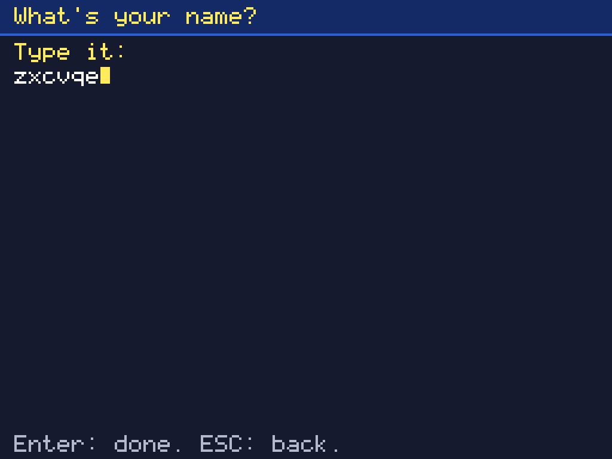
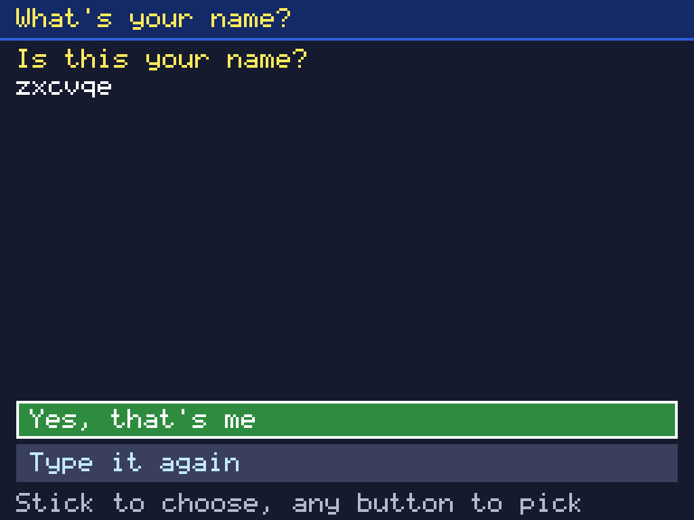
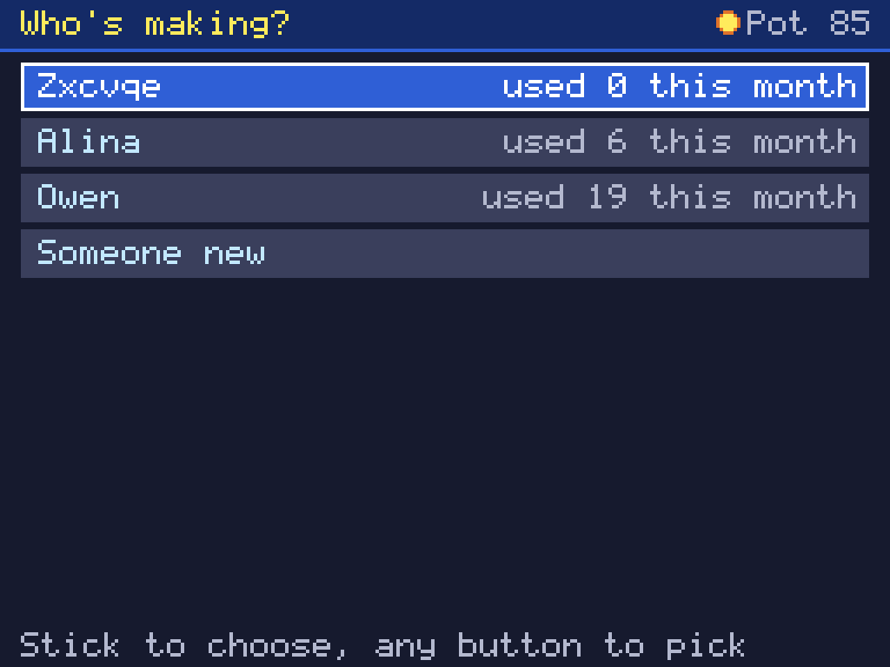

### I2. "Type instead" is offered on every talk screen and can't be used

- **Screens:** M4 "Tell me your game idea", M8 "Something else", R4 and the plan's "Change it", and E9 "I didn't hear anything".
- **What happens:** the hint says "F1: type instead". F1 is the ENT button. One press opens "Type it:", where the same thing happens as in I1: buttons type z x c v q e, and START sends it.
- **It can start a real make.** Pressing ENT, then A A B, then START gives "Is this right? I heard: zzx". The lit tile is "Yes! That's it", and one more press starts a make of "zzx" that spends coins.
- **A kid can get here by accident:** ENT is also the volume key (D421). Hold ENT, let go without pressing a pink, and the talk screen turns into the typing screen.
- **Not a dead end:** ESC goes back to the mic.
- **Reproduce:** `flows/names.drive`, second half.
- **So with a mic that isn't working, nothing can be made.** Ideas, "Something else" and "Change it" all need words, and typing is the only fallback.
- **Suggested fix:** the same stick keyboard as I1, opened by ENT. Until then, don't offer typing on a cabinet with no keyboard.

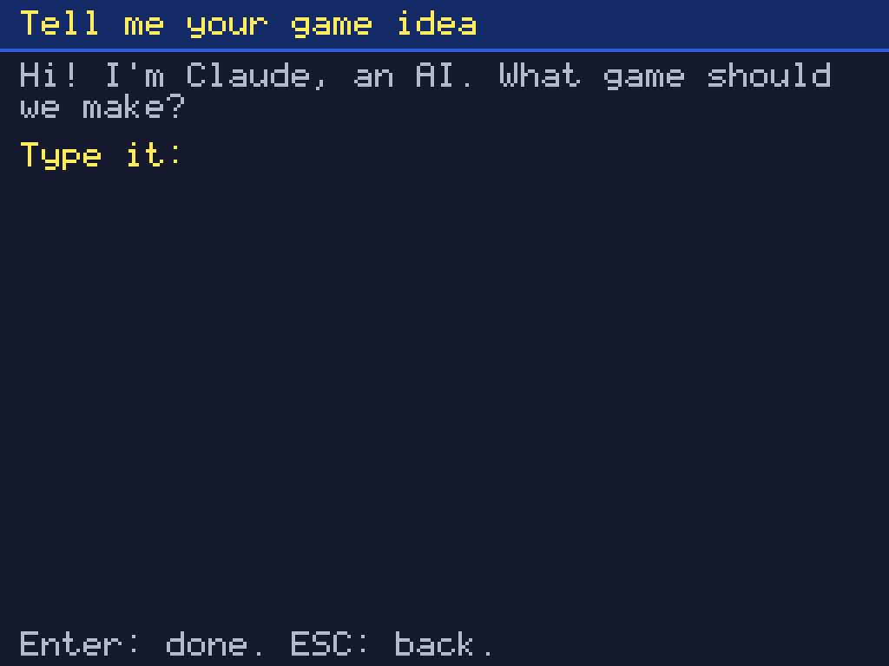
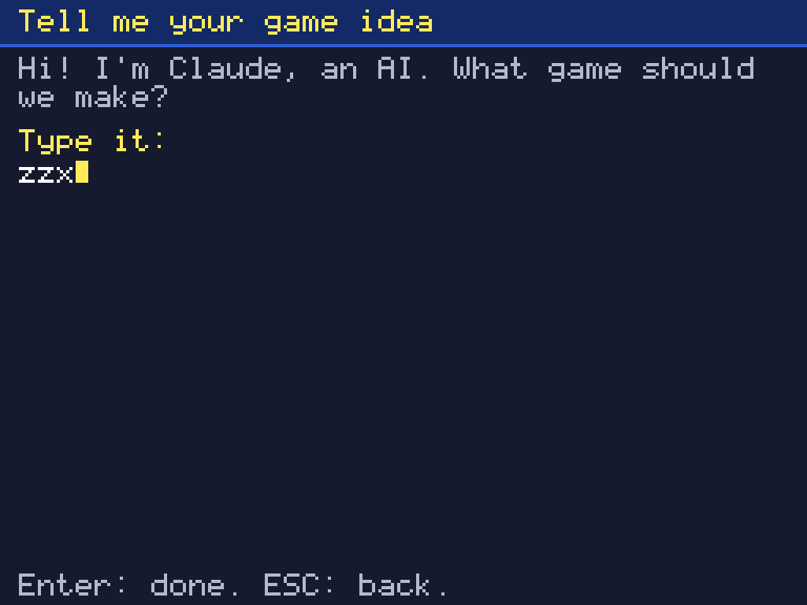
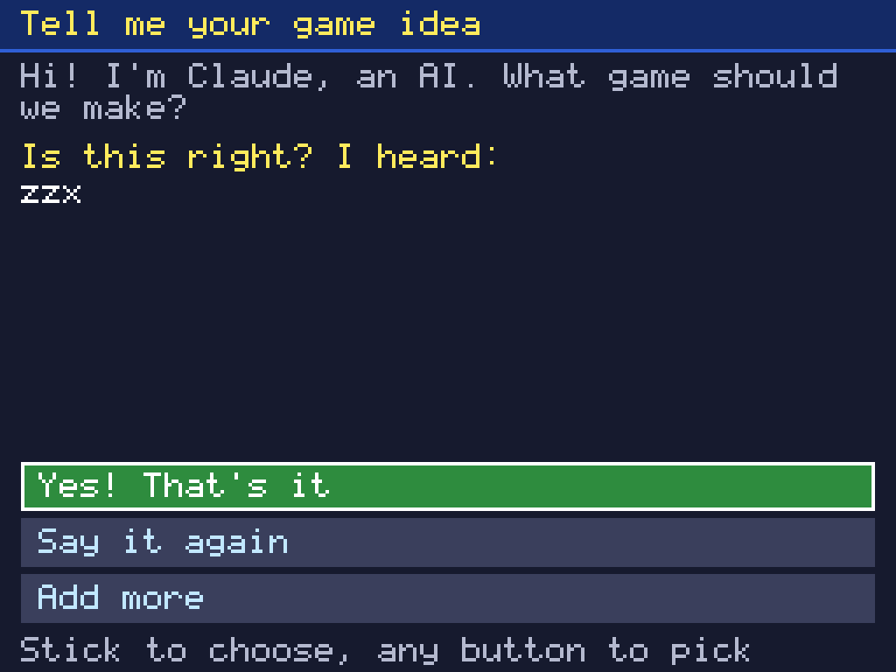

## Confusing

### C1. ENT inside a game may open the browser's help page. Check this on a cabinet first.

- **Where:** any game, house or guest.
- **Why it might:** the launcher stops the browser's own handling of every key, except while a game is playing (`app.js`, the `play` branch returns first). The runtime only stops the keys it maps, which don't include F1 or F2. The guest page's script only stops Escape. Chromium's own F1 is "Help", which opens a web page.
- **Why it matters:** D421 asks kids to hold ENT in a game to change the volume. If the kiosk opens a help page, there is no key on the cabinet that closes it. That would be a dead end only the power button gets out of.
- **Not proven either way.** Headless Chromium doesn't run browser shortcuts, so I couldn't see it. D421 also lists the chord in a game as "not yet proven on the Picade".
- **To check:** on the virtual cabinet, start any game and press ENT. Ten seconds.
- **Suggested fix, whatever the check says:** stop F1 and F2 in all three places (the launcher's play branch, the runtime host, the guest script). It's three lines and removes the doubt.

### C2. The hints name keys the cabinet doesn't have

- **Screens and words:** M4, M8, R4: "F1: type instead. ESC: back." E9: "Hold a button to try. F1: type it." The typing screens: "Enter: done. ESC: back."
- **The cabinet's names** are ENT and START (the X HAT header says 1UP). There is no F1 or Enter.
- **Also mixed:** the Wi-Fi keyboard says "1UP: join"; the game screens say "START".
- **Suggested fix:** one name per button everywhere, the one printed on or beside it. This goes away for typing if I2 is fixed.

### C3. No mic and silence get the same message

- **Screen:** E9.
- **What happens:** with the mic unplugged, the service logs "no capture device; is the mic plugged in?" and returns no words. The kid sees "I didn't hear anything. Hold a button the whole time you talk.", and will keep trying.
- **Seen in:** `speech-live.js` (`alsaRecorder.start`). Not run: the mini has no real speech.
- **Suggested fix:** when there's no capture device, say "The microphone isn't plugged in. Ask a grown-up.", and offer "Back to the shelf".

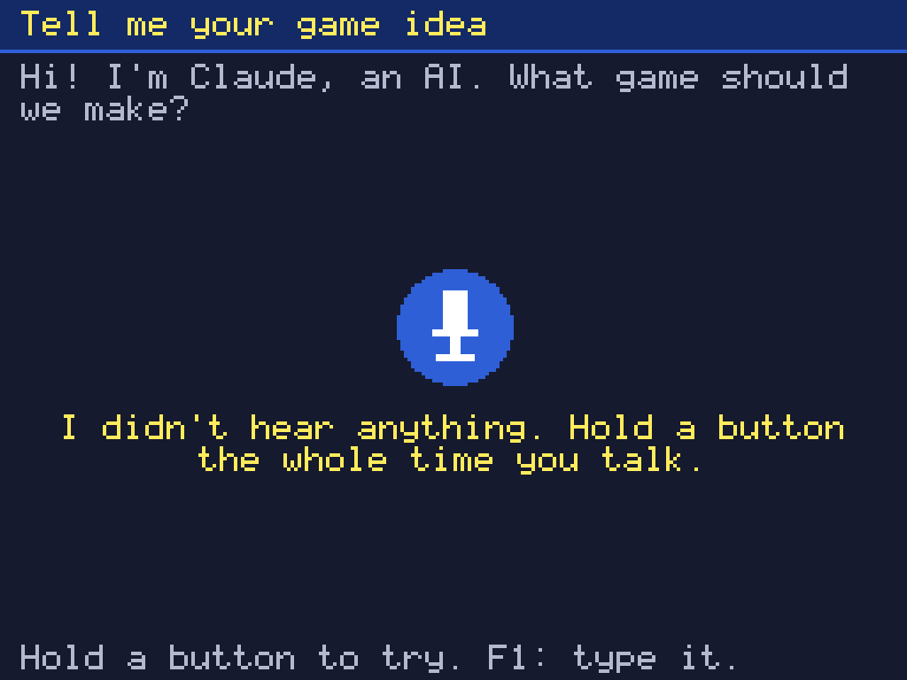

### C4. On the plan, the stick's right doesn't reach the tile on the right

- **Screens:** M9 "Here's the plan" and R6 "What changes".
- **What happens:** "Build it!" and "Change it" sit side by side. Stick right opens "All the rules". Stick down lights "Change it"; up or left lights "Build it!".
- **The hint is accurate** ("Up/down: choose. Right: every rule.") but a kid who pushes toward the tile they want gets a different screen.
- **Reproduce:** `flows/make-edges.drive`.
- **Suggested fix:** stack the two tiles like every other board, so up and down match what's drawn. Or keep them side by side and make left and right choose, with the rules on a third tile.

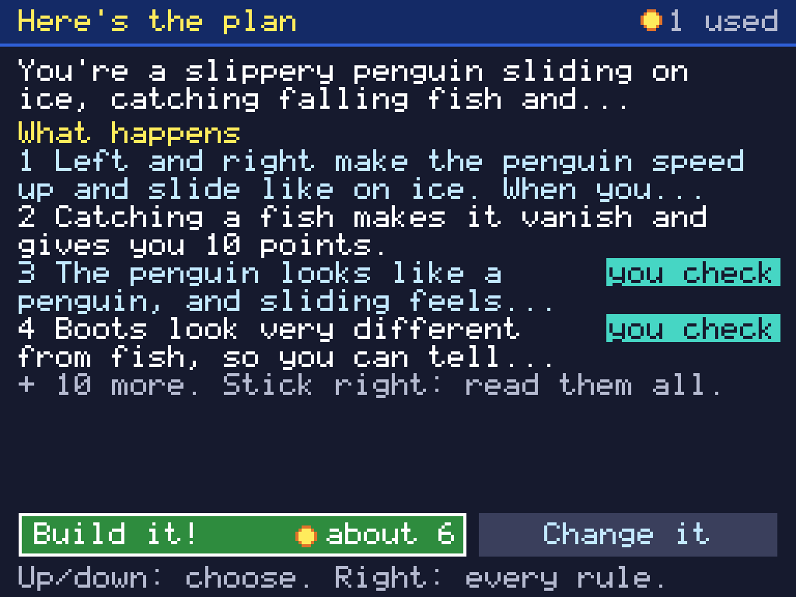
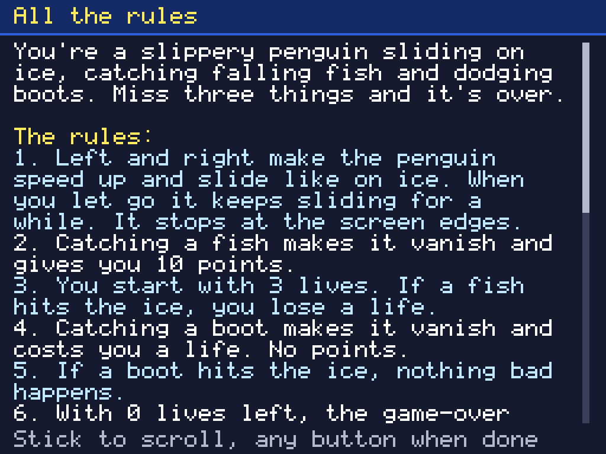
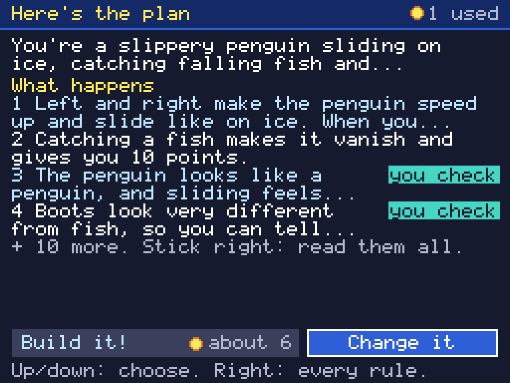

### C5. On the coin check, the lit tile does nothing when you press a button

- **Screens:** M3 and R3.
- **What happens:** "Press COIN to start" is lit, the way a pickable tile is. Any of the six buttons or START on it does nothing, with no sound or message. Only COIN works.
- **By design** (D205), and stick down to "Not now" works. But every other screen says "any button to pick", and nothing says which black button is COIN.
- **Suggested fix:** on a wrong button, flash a line: "COIN is the black button on the front, on the right". Draw the tile as a sign rather than a pickable tile.

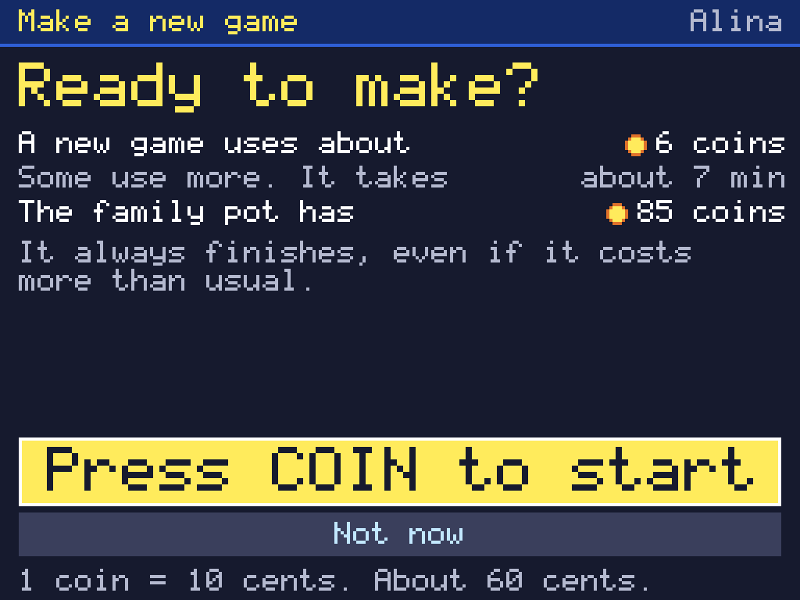

### C6. The welcome screen teaches four controls, once, and ESC there does the opposite of what it says

- **Screen:** B2 "How it works", first switch-on only.
- **What it says:** Stick choose, Any button pick, ESC go back, COIN the coin pot.
- **What it leaves out:** START, hold a button to talk, that ESC leaves a game, where ESC and COIN are (they're two of four identical black buttons), and the volume (ENT with a pink).
- **Shown once per cabinet,** to whoever is standing there. The other kid, and any friend, never see it. There's no way to see it again.
- **ESC on B2 goes forward to B3,** while the screen says "ESC: go back".
- **Suggested fix:** a "How it works" row at the bottom of the shelf that opens the same screens. Add a picture of the panel with each button named.

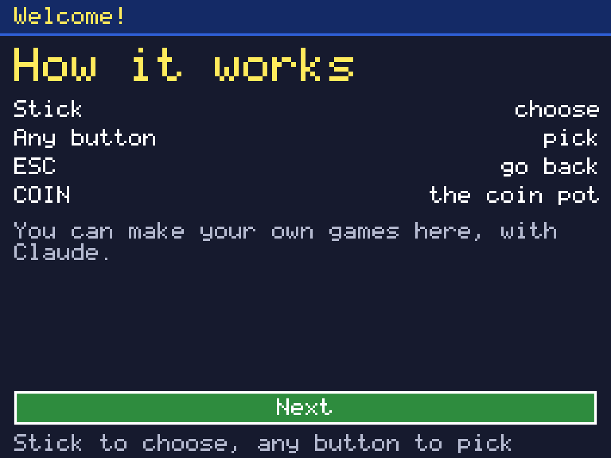

### C7. A question times out while a kid plays teti, though they're pressing keys

- **Where:** a make is running, the kid presses ESC to "play something else meanwhile", and picks teti.
- **What happens:** when Claude asks a question, the 10-minute clock starts. Keys pressed in a house game reset it. Keys pressed in a guest game don't: the guest runs in its own frame and the launcher never sees them. After 10 minutes the make is released and its coins stay used.
- **Also:** nothing shows over any game when Claude has a question, so a kid deep in a game doesn't know. The "Still there? Move the stick!" warning shows only on the question and the shelf.
- **Contradicts:** D188, "no key pressed anywhere on the cabinet, including in a game".
- **Seen in:** `app.js` (`noteActivity` is on the launcher's own key events) and `launcher/guests.js`. Not run end to end.
- **Suggested fix:** the guest page's script tells the launcher about any key, as it already does for Escape. Show a small banner over any game, the way the volume bar is drawn: "Claude has a question! Press ESC".

### C8. House games can't be paused; teti can

- **Where:** every house game played: Apple Catch, Comet Dodge, Wall Ball, Candy Cat Drop, Log Hopper.
- **What happens:** START during play does nothing. The game runs on. teti's START opens "Paused" with "Keep playing / Start over / Pick another game".
- **The only way to stop a house game** is ESC, which ends it.
- **Reproduce:** `flows/games.drive` (the `start-again` captures) and `flows/teti.drive`.
- **Suggested fix:** one pause for every house game, in the host rather than each cart (the host already has `pause()`). See C9: the same screen can ask before leaving.

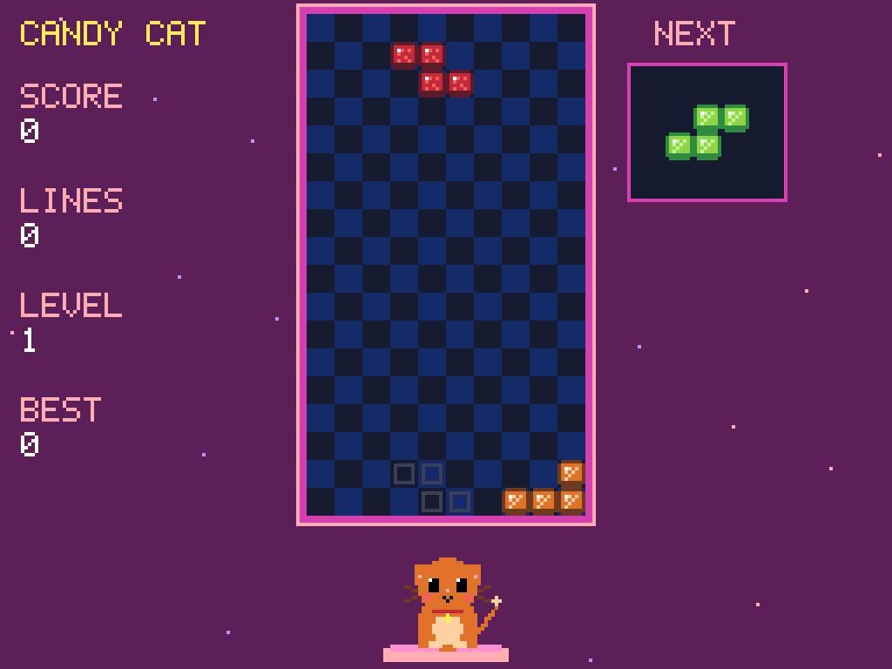
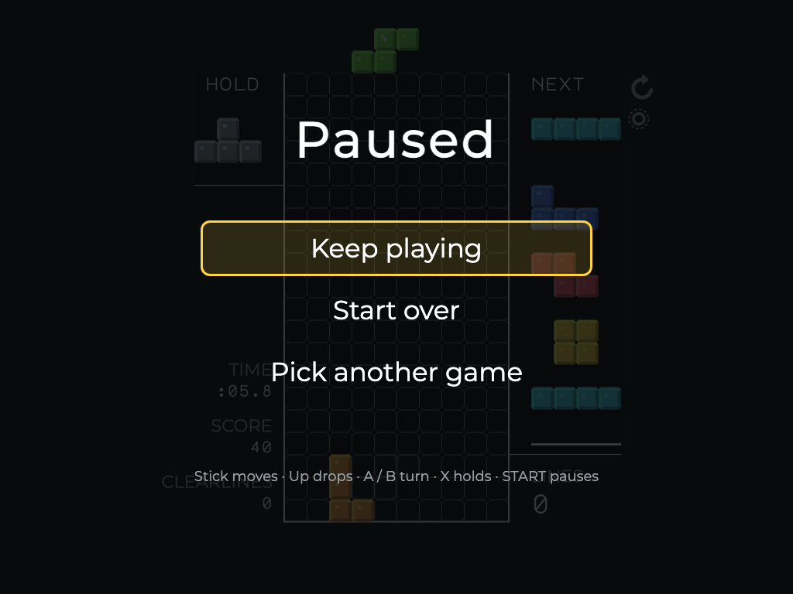

### C9. One press of ESC ends a game, with no "are you sure"

- **Where:** any game.
- **What happens:** the play ends at once and can't be resumed. For a made game the you-check questions follow, about a game the kid didn't mean to leave.
- **By decision so far:** D88 chose one press and left "should a stray press need a second" open.
- **Suggested fix:** ESC pauses and asks "Keep playing / Back to the shelf", with "Keep playing" lit. That gives house games their pause (C8) with the same screen.

### C10. While the service is down, no control does anything, and the screen never says what to do

- **Screen:** E4 "Just a moment. The cabinet is restarting."
- **What happens:** every key is ignored. When the service comes back the shelf returns by itself (8 seconds in the test). If it never comes back, the screen stays like this for ever.
- **Reproduce:** `flows/redirect-restart.drive`.
- **Suggested fix:** after a minute, add "Still stuck? Hold the power button until the screen goes dark, then press it again."

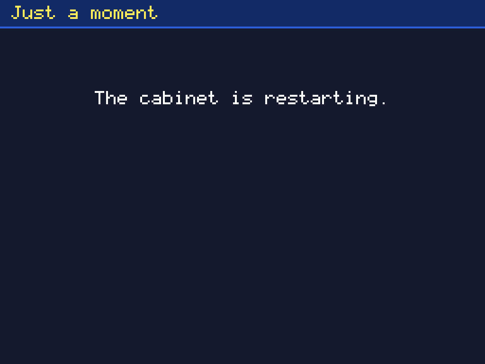

### C11. The power button gives no sign it's working

- **From D372, not tested here.** A tap does nothing. Holding 2 s switches off, with nothing on screen until it goes dark. The X HAT cuts power hard at about 3 s, so a kid who holds on may cut the shutdown short.
- **Suggested fix:** D372 already names it: a "Switching off..." screen as soon as the hold is seen.

## Polish

| # | Screen | What | Suggested fix |
| --- | --- | --- | --- |
| P1 | R1, offline | "Change this game" with no Wi-Fi asks "Who's changing it?" first, then says Claude can't be reached. | Check for Wi-Fi before asking who. |
| P2 | M4, M8 | Talking stops being recorded at 30 seconds, with no sign. The words after that are lost. | Count down the last 5 seconds on screen. |
| P3 | E13, E14 | On the replay, "Stop making this game?" says "1 coin used", then the shelf's note says "It used 7 coins (68c)". | Check on a live make. If it's real, say "about" on E13. |
| P4 | W1 | Straight after joining a new network, the list still marks the old one "on now" until the next look. | Mark the joined network at once. |
| P5 | W3 | ESC is ignored while joining. The screen says "half a minute"; the service waits up to 150 s for the helper. | Say "ESC isn't needed: this ends by itself", or allow leaving after 45 s. |
| P6 | W1 | A network that hides its name can't be joined at the cabinet (D414 says so). | Leave it; say so in the grown-up's guide. |
| P7 | Shelf | Both teti rows are titled "teti". Geoff's "How to play" doesn't say it's his version. | Show the maker's name on G0, as made games do. |
| P8 | teti | Its help line ("Stick moves · Up drops · ...") is 18 px on a 1024×768 screen. | Make it at least as big as the mode's line above it. |
| P9 | E13 | Its tiles carry A and B letters. Tiles elsewhere (except Claude's questions) don't, and the cabinet has buttons called A and B (the mistake D182 describes). | Drop the letters on E13. |
| P10 | G0 | "ESC: back" is about this screen. Nothing here says ESC leaves the game once it's started. | "Any button: start. ESC in the game: back to the shelf." |
| P11 | Shelf | The hint doesn't mention stick right for a game's card, which is the only way to an older version. Only a small arrow on the row shows it. | Add "Right: more" to the hint when the lit row has a card. |
| P12 | `docs/hardware/picade-wiring.png` | It says ENT is "type it instead, with a keyboard" and the pinks are "unused for now". Since D421 they're the volume. | Redraw the sheet's "What each one does". |

## What works

Every screen below was reached and left with only the cabinet's controls.

| Area | Screens | Result |
| --- | --- | --- |
| Start | B1, B2, B3, B4 | Fine. ESC on B2 to B4 moves on (C6). |
| Shelf | S1, S2, S3, the scroll past six rows | Fine. Guests join a few seconds after the first start, once the publish gate has checked them. |
| Coin pot | A1, A2 | Fine. COIN opens it, any button opens the history, ESC steps back. |
| Play | G0, G1, G2, G3, G4, G5, G6 | Fine. ESC leaves every game; you-check can be skipped with ESC. |
| Make | M1, M3 to M11 | Fine with a working mic. M2 is I1. |
| Change and fork | R1 to R9, R2 "Someone else's game" | Fine. |
| Leaving a make | E8 leave, E13 stop, E14 idea saved, S2 "Claude is waiting" | Fine. ESC on E8 or E13 goes back to the question. |
| Walk-away and restart | E5, E6, E7 | Fine. |
| Limits | L1 to L5, E3 failed make | Fine. Each has a tile back to the shelf, and ESC does the same. |
| Redirect | E10 | Fine. All three tiles and ESC lead somewhere sensible. |
| Offline | E1, E2 | Fine. Games play; Make explains. |
| Wi-Fi | The hold (ENT and COIN, 3 s), W1, W2, W3, W4 | Fine, from the shelf and from the pot. A 9-character password was typed with the stick and joined. W5 wasn't run (the pretend Wi-Fi needs a specific wrong password); its three tiles were read in code. |
| Volume | ENT with a pink | Pressed inside teti: the game ignored it. On the launcher's own screens the chord was read in code, not driven (D421's test drives it). The bar and the level need the Picade. |

### The games

| Game | Start | Play | Pause | Leave |
| --- | --- | --- | --- | --- |
| Apple Catch (starter) | START or A | Stick left and right | No (C8) | ESC |
| Comet Dodge (starter) | START or A | Stick | No | ESC |
| Wall Ball (starter) | START or A | Stick up and down | No | ESC |
| Candy Cat Drop | START or A; stick picks 1 or 2 players | Stick, A, B | No | ESC |
| Log Hopper | START or A | Stick | No | ESC |
| teti | Any button on its picker | Stick, A, B, X, Y | START | ESC |
| teti (Geoff's) | The same | The same; reports its score | START | ESC |
| Cloud Popper | Not played: its cart isn't on the mini | | | |

- **Two players on one set of controls works.** Candy Cat Drop's "2 PLAYERS" plays in turns with "PLAYER 2, YOUR TURN, PASS THE CONTROLS, PRESS A" between them (D85).
- **ENT, COIN and the pinks do nothing inside any game** as far as the page is concerned. What the browser does with ENT is C1.
- **The title screens blink "PRESS START"**, so half the captures show it and half don't.

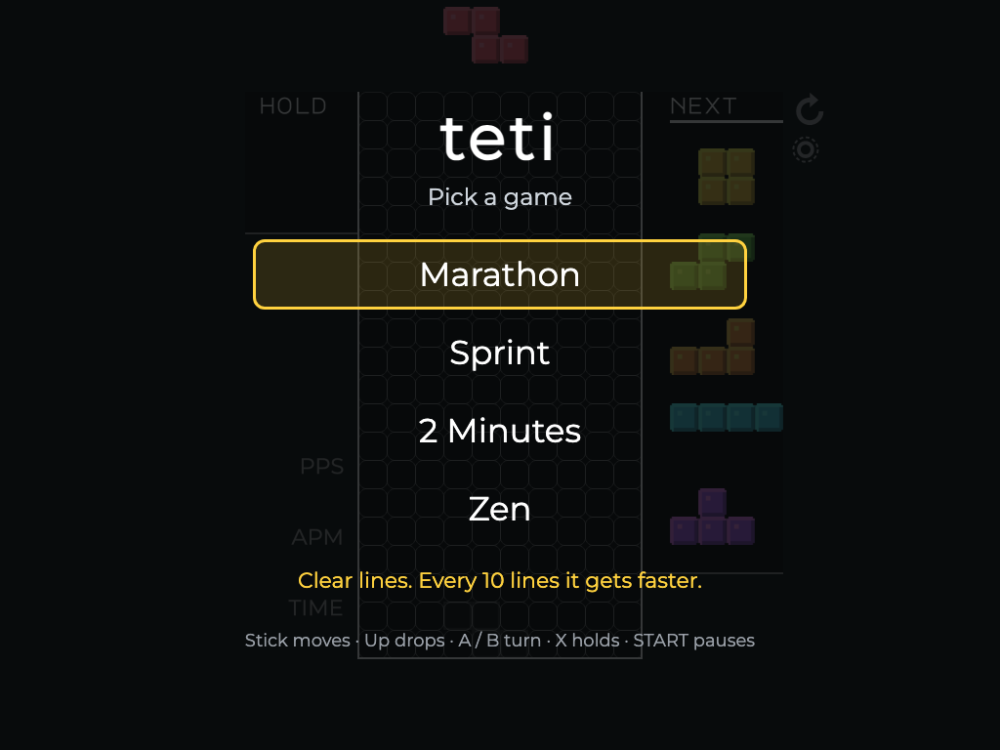
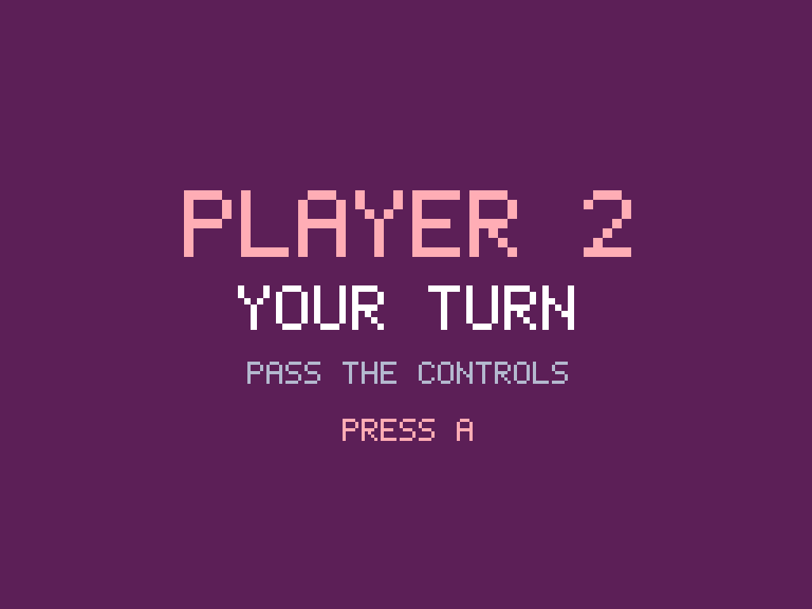

### The Wi-Fi screens

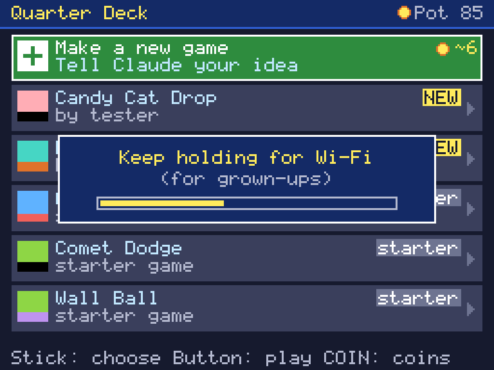
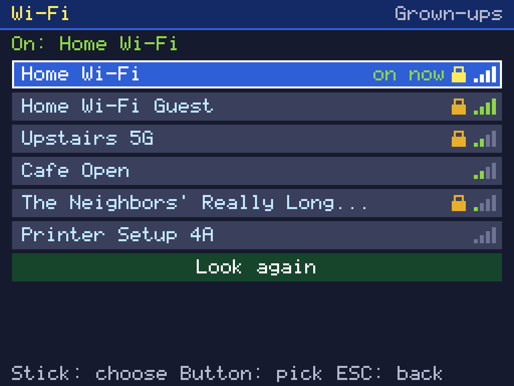
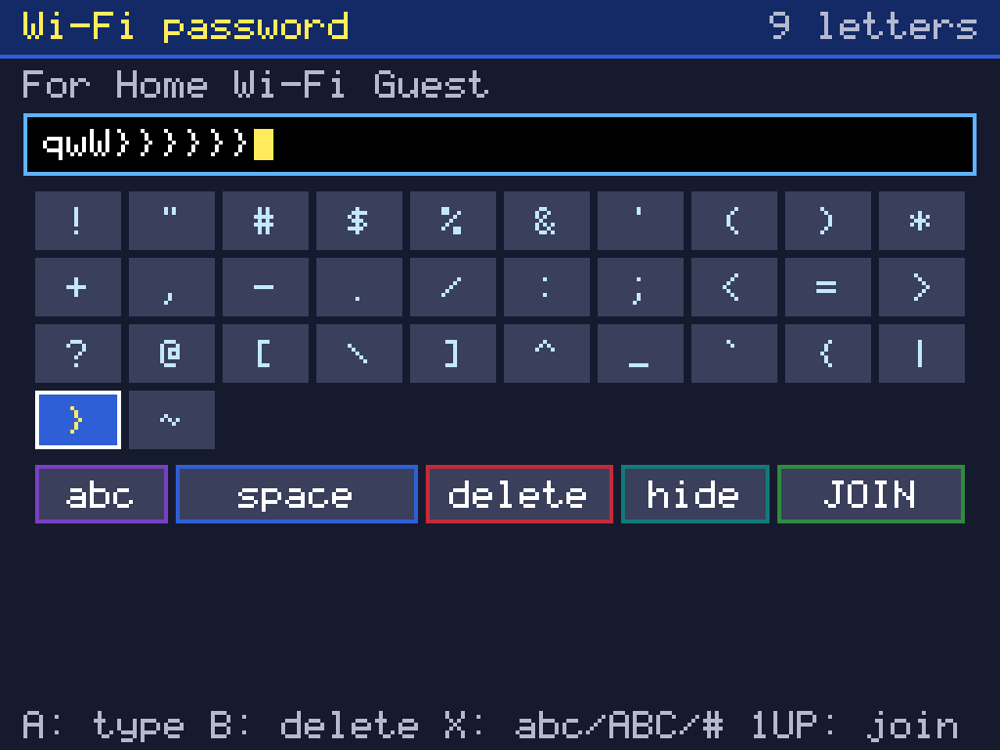
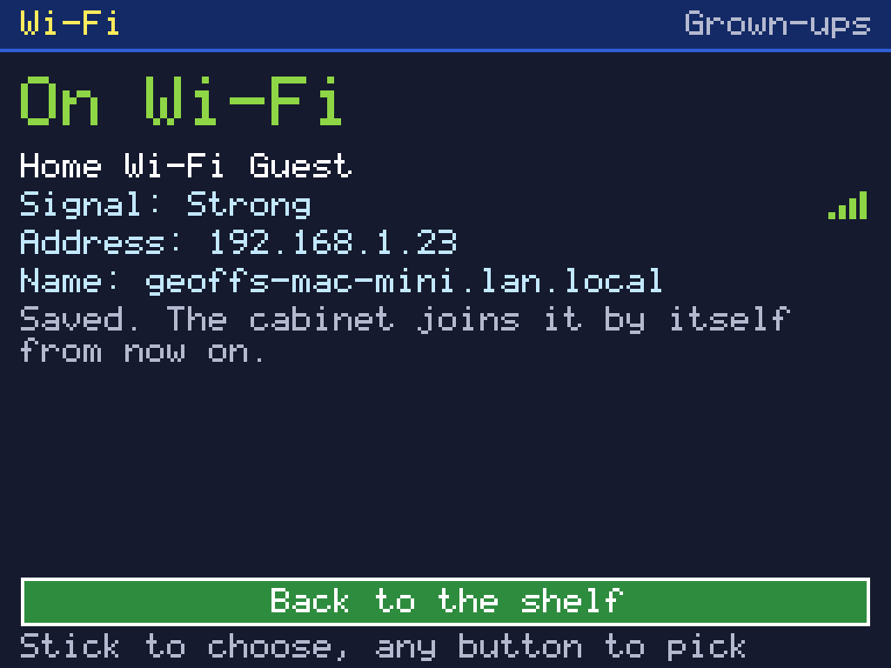

## Dead ends

**None that the controls can't get out of**, apart from C1 if the check goes badly. The places where a control does nothing:

| Screen | Does nothing | Way out |
| --- | --- | --- |
| E4 restarting, B1 warming up | Everything | Waits for the service (C10) |
| W3 joining | Everything, ESC included | Ends by itself (P5) |
| M3, R3 coin check | The six buttons and START on the lit tile | COIN, "Not now", or ESC (C5) |
| M2 and the typing screens | The stick | ESC (I1, I2) |
| M10, R7 making | The six buttons and START | ESC to the shelf; the make carries on |
| A2 coin history | The six buttons | ESC |
| Any house game | START mid-game, ENT, COIN, the pinks | ESC (C8) |
| The shelf | ESC; ENT alone | It's the top |

## Against the decisions

| Decision | What it says | What the cabinet does | Finding |
| --- | --- | --- | --- |
| D87 | A new name is spoken and confirmed | It's typed | I1 |
| D184 | Names move to hold-to-talk when real speech comes | Real speech came (D260); names still type | I1 |
| D184 | "The Picade has no keyboard, so real speech must land before kids use it there" | Speech landed, but typing is still offered on every talk screen | I2 |
| D188 | The walk-away clock counts keys "anywhere on the cabinet, including in a game" | Keys in a guest game don't count | C7 |
| D88 | ESC goes back | On B2 to B4 it goes forward | C6 |
| D421 | The wiring sheet's ENT and pinks | The sheet predates it | P12 |

Nothing else was found against the locked decisions. Play never needed the mini or the network. No new decision numbers were used.

## Suggested order

1. **Check C1 on the virtual cabinet** (ENT in a game). If it opens a page, it's the worst thing here.
2. **Check who's in the Picade's maker list** (I1). If it's empty, nobody can make a game on day one.
3. **I1 and I2 together:** one stick keyboard, used for names and for "type instead".
4. **C8 and C9 together:** ESC and START open one pause screen in every house game.
5. **C2, C4, C5, C6:** words and layout only.
6. **C3, C7, C10, C11:** small service and launcher changes.
