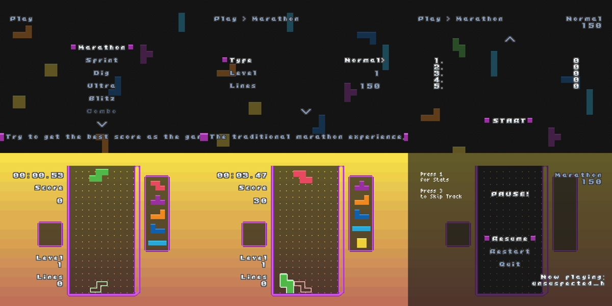
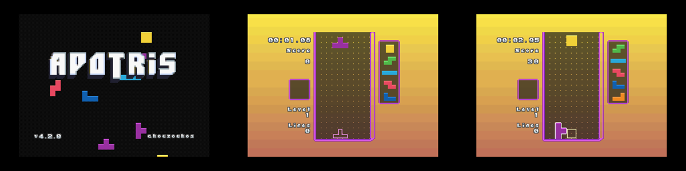
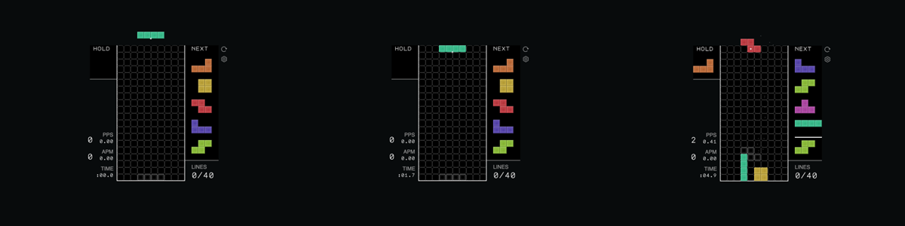
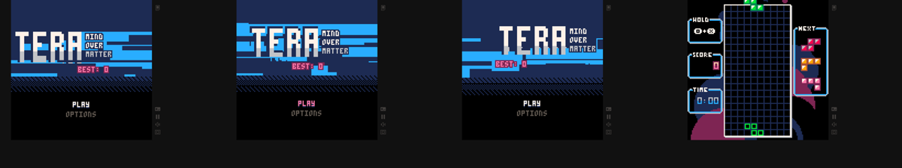
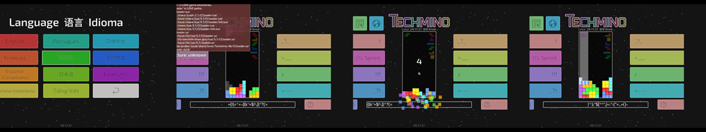
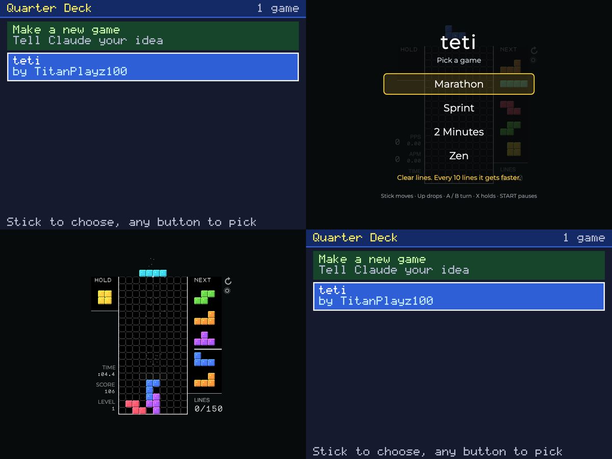

# Downloaded games on the cabinet: the stack, then a falling-blocks pick

Phase 1 of `tasks/ship-a-high-quality-tetris-like-game-on-the-cabinet.md`. Researched and run 2026-11-11. Nothing was installed on either cabinet, and the virtual cabinet's VM was left alone.

Geoff's steer (2026-11-11):
- The cabinet OS needs an easy way to add existing games.
- Where possible, the games should be modifiable in a token-efficient way.
- So the third-party game stack gets chosen first, and the games are judged on fit and hackability after that.

The house rule "inspired-by, no Tetris name or look" covers games the Studio makes. For a downloaded game, this report states its licence and whether it uses the Tetris name or trade dress. **One open question:** if a kid forks a downloaded game in the Studio, is the result a Studio-made game? That would bring it under the house rule.

## 1. The third-party stack

| Stack | Adding a game | Escape → shelf | Hackability | Licence and bundling | Fit |
|---|---|---|---|---|---|
| **Web game in the kiosk** (HTML5/JS, plus WebAssembly builds) | Drop a folder and a manifest. The cabinet service serves it, and the launcher opens it in an iframe on the same origin. | One fix covers every game: a capture-phase listener on the iframe's window. | Plain JS: edit and reload. WebAssembly: edit the C/C++ source and rebuild. | Per game | Same Chromium the house runtime and launcher already use; no second program on the screen |
| **TIC-80** (MIT) | Drop a `.tic` file. TIC-80's own web player can run in the kiosk, or the native arm64 player. | Web: as above. Native: needs an evdev-level grab. | The whole game is one small text file of Lua or JS (64 KB of code per bank) | Player can be bundled | Good; few strong falling-blocks carts exist |
| **PICO-8** (Geoff's licence) | Drop a `.p8` or `.p8.png` file, then run it in native PICO-8, or export HTML with PICO-8 and serve it in the kiosk | Native: PICO-8 drops to its console on Escape, so the launcher must take over. Web: as above. | The whole game is one text file, capped at 8,192 PICO-8 tokens and 65,535 characters, so roughly 20k model tokens at most | Personal licence: never in the image (platform-notes), and by the same reasoning never uploaded to a Managed Agents sandbox. Exporting needs Geoff's copy. | Huge library (BBS carts default to CC BY-NC-SA) |
| **Native Linux** (LÖVE, SDL) | Drop a binary or `.love`; the launcher hands over the screen | Needs an evdev-level grab | LÖVE: Lua source, but big games are big. SDL binaries: rebuild. | Per game | Second program on the screen; Pi GPU differences |
| **RetroArch / libretro** (GBA or NES homebrew) | Drop a ROM | Escape quits RetroArch, so it's recoverable | ROMs are compiled: rebuild with retro toolchains, or no source at all | Cores vary | Easy to add, worst to modify |

**Choice: web games in the kiosk are the one way downloaded games reach the shelf.** TIC-80 and PICO-8 carts come in through their web players or exports. Native players come later, and only if a must-have game has no web build. The reasons:

- **One way in.** The launcher, Escape, play logging and kiosk lockdown are solved once, inside the Chromium that already runs the house runtime. Nothing new takes over the screen, and cabinet independence is unchanged.
- **The Studio's tools already work on it.** The playtest harness and `scripts/drive.js` drive and screenshot headless Chromium. So when Claude changes a guest game, it can check the change the same way it checks a cart. That's what makes changes cheap to verify, not just cheap to write.
- **Adding a game stays a file drop.** A guest game would be a folder shaped like a cart:
  - `guest.json`: title, source URL, version, licences, Tetris-dress note and key map;
  - `play/`: what gets served;
  - `src/`: editable source, or the source tarball for a compiled game;
  - a build recipe, if it has one.
  
  Versions are appended, never deleted, as with carts.

**Hackability tiers** for judging games on this stack:
- **A, edit and reload:** plain JS/HTML, TIC-80 and PICO-8 carts. Claude reads only the files it needs, and the whole game fits in context.
- **B, edit and rebuild:** C/C++ to WebAssembly (Emscripten), or LÖVE through love.js. Needs a toolchain and a big codebase. Data-level changes (skins, music, settings) may still be cheap.
- **C, binary only:** don't pick these.

## 2. How the games were run

- **Web builds** ran in headless Chromium (Playwright 1.56.0) at 1024×768, driven with D82 keys.
- **Native arm64 builds** ran in a throwaway Debian 13.7 trixie arm64 VM. It was qemu with HVF, headless, and is not the virtual cabinet. Each game ran under Xvfb at 1024×768, with keys from `xdotool` and screenshots from `import`. That checks the OS, the architecture and the libraries (glibc 2.41). It doesn't check the Pi's GPU or speed: rendering was software (llvmpipe).
- **Not checked:** sound output (audio went to a dummy device every time), and anything on a real Pi 5.
- **Source sizes** were measured from each project's source. Model tokens are estimated at 3.5 characters per token.

## 3. The games, on this stack

| | Apotris | teti | Tera: Mind Over Matter | Techmino |
|---|---|---|---|---|
| Web build | Yes, official | Yes, plain JS | Yes, via PICO-8 export or BBS player | No |
| Hackability | **B**: 51k lines of C++ in `source/` plus 58k in `include/`, about 1M tokens in all. Rebuild with Emscripten 3.1.51 or later and Meson. Skins, colours, music and key bindings change in its settings with no code. | **A**: 6.5k lines of plain JS, about 67k tokens in all, no build step | **A**: one PICO-8 cart, at most about 20k tokens | B/C: 67k lines of Lua, about 690k tokens; native LÖVE only |
| Feel | Modern: hold, 5-piece next, ghost, 14 modes including Marathon with levels | Modern: SRS+, hold, 5-piece next, ghost, lock indicator, Sprint, Blitz, Dig, Survival and others. **No rising gravity yet** (on its own to-do list). | Hold (Z+X), ghost, 3-piece next, lock delay; one main mode | Huge |
| Look for a 10-year-old | Bright pixel art, made for 4:3 | Plain, dark, competitive-player look (PPS/APM readouts) | Charming pixel art | Busy; 16:9 cut off at 4:3 |
| Licence | Code AGPL-3.0. Music from The Mod Archive, credited, each track's licence not checked. | Code MIT. **Sounds are TETR.IO's and music is commercial Touhou arrangements**, so both would need replacing. Loads pixi.js and GSAP from a CDN at `@latest`, so those would need vendoring for offline play. | CC BY-NC-SA 4.0 (changes allowed, share-alike, non-commercial) | LGPL-3.0 |
| Tetris name or look | "-tris" name, guideline colours. **Tetris Holding sent it a DMCA takedown (itch.io, 2023-05-05).** | Guideline colours; skins named after TETR.IO and Jstris | Neither | Guideline colours; says it is "not a fan game of Tetris" |
| Seen running | Web build (menus, Marathon, play, pause) and the arm64 binary on trixie | Locally served in headless Chromium: Sprint, with hold, ghost and next | BBS player: title, play | `.love` on trixie's `love` 11.5: menus need a pointer, and the AI library is missing on arm64 |
| Two players | Online and GBA link only | No | No | Online and vs AI |
| Last update | v4.2.0; commit 2026-10-20 | Push 2026-06-03 | v1.2, 2019-03-06 | v0.17.21; push 2026-11-10 |

Screenshots:
- Apotris web: 
- Apotris arm64: 
- teti: 
- Tera: 
- Techmino: 

**Dropped earlier:**
- **Cambridge:** MIT code, but its own `SOURCES.md` lists unlicensed placeholder backgrounds and music, including "Black Death Village". It's TGM-hard.
- **Quadrapassel:** a GTK desktop app with no hold, and it crashed under Xvfb.
- **Extreme Tetrom:** built to be extremely hard.
- **Tetr.js:** no licence.
- **TIC-80:** no strong falling-blocks cart found.

## 4. Recommendation

**Stack: web games in the kiosk**, as above.

**Game: it depends which matters more, and that's Geoff's call:**
- **Apotris** for the best game today. It's tier B: changes to its look, music and controls are cheap through its settings, skin editor and music folder, but changes to how it plays mean C++ and an Emscripten build. It also carries the DMCA history.
- **teti** for the most hackable modern game. It's tier A: 6.5k lines of plain JS, with no build step. Before it ships it needs a cleanup pass:
  - replace its sounds and music with CC0 or our own;
  - vendor pixi.js and GSAP at pinned versions;
  - add rising-gravity Marathon;
  - a kid-friendly skin;
  - D82 keys.
  
  All of that is cheap in tier A, and every later change stays cheap.
- **Tera** is the clean, small tier-A choice, if one mode is enough.

## 5. Phase 2: teti on the shelf (built 2026-11-11)

Geoff picked teti, cleaned up. Decisions D230–D233. It was built and tested locally (headless, against the real service process). **It hasn't been put on the virtual cabinet yet: that waits for the director's go**, because the arcade UX build also needs the VM.

- **The cleaned-up teti (`guests/teti`)**
  - Upstream code is pinned to commit 1de7944 and committed unmodified first, so the history of `guests/teti` shows every cabinet change. Each change is marked `cabinet:`.
  - All sounds, the music loop ("Brick Parade", an original tune), the skin, the particle and the icons are generated by `guests/teti/tools/make-assets.mjs`.
  - pixi.js and GSAP are vendored at pinned versions, and the fonts are local. A test checks that nothing loads from the network.
  - New modes: Marathon (levels and speed-ups) and Zen.
  - `src/cabinet.js` gives a game picker, pause and game over, all on stick and buttons.
  - `NOTICE.md` lists every file's origin and licence.
- **Guest games in the service and launcher**
  - The code is in its own files (`src/guests.js`, `launcher/guests.js`), with one hook in `server.js` and three in `app.js`.
  - **This changes the plan in §1 and §6:** guests play on their **own origin** (`127.0.0.1:8340` by default, `guest_port` in the cabinet config), not the launcher's. A downloaded game can't call the cabinet's APIs, and Escape still works: the service puts a small script first in the guest's page, and it hands Escape to the launcher (D232).
  - Plays go to `logs/guest_play.jsonl`.
- **Tests:** `test/guests.test.js` and `test/guests.browser.test.js`. The service suite passes: 73 of 73. The virtual-cabinet script tests pass too: 29 of 29.

**Proposed (not built) for the arcade UX (D201):**
- **G0, how to play:** guests show it too, from `guest.json`'s `howToPlay` (goal and controls are already there).
- **Post-game screen:** a guest ends with Escape, so the next screen is just "Play again" and "Back to the shelf". There's no "change it?" until the Studio can change a guest game. That needs D233's open question answered (is a kid's change to a downloaded game a Studio-made game?) and fork support.
- **Coins:** playing a guest costs no coins (D230).
- **The shelf:** a guest row reads "by <author>", with a "free game" tag where starters have "starter".

**Left to do:**
1. With the director's go: update the virtual cabinet, then check on it that teti is on the shelf, plays with the cabinet's keys, and Escape goes back. The bundle now includes `guests/`, and the service starts the guest port by default, so no provisioning change is needed.
2. Rebase onto the arcade UX build when it lands.

**Probe machinery on the mini, to clean up when convenient:**
- `qemu` 11.1.3 (Homebrew, 729 MB): `brew uninstall qemu`.
- The probe VM's files are in the job's tmp folder, `~/.claude/jobs/dd60e8a2/tmp/vm/`: the trixie cloud image (338 MB), its overlay disk, a seed ISO and a throwaway SSH key. The VM is powered off. The folder goes when the job is deleted.
- `~/.claude/jobs/dd60e8a2/tmp/dl` and `npm`: downloaded sources (Apotris, Techmino, teti) and npm tarballs. These also go with the job.

## 6. What the cabinet lacked, and the smallest way in (Phase 1's plan)

Guest players aren't built (decisions.md, "Stubbed or not here"). The shelf lists only house carts. `createHost` (`runtime/src/host.js`) keeps focus on the launcher and forwards input into a sandboxed iframe, which is how Escape always reaches the launcher. A downloaded web game reads the keyboard itself, so focus has to be inside its page.

The smallest way, for any web game (Phase 2):
1. **Shelf entry:** a guest entry kind (`guest.json`) listed beside carts, with plays logged through `/api/plays` as now.
2. **Files:** the cabinet service serves the game's `play/` folder on the same origin. Provisioning pins the version by checksum, with source kept alongside, which the AGPL needs for Apotris.
3. **Launcher:** for a guest entry, it opens a full-screen iframe on the same origin. A capture-phase `keydown` listener on its window, added before the game's scripts run, swallows Escape and ends the play.
4. **Controls:** the key map lives in the game's settings. It's a shipped starting save for Apotris, and a one-line default for teti or Tera.
