# Guest players: the shortlist for Geoff

TIC-80 carts and homebrew console games play from the shelf, as web players in the kiosk (D380–D389). Geoff picked six (2026-11-14, D388): **8 Bit Panda, Cauliflower Power, Grow Quickly, Tobu Tobu Girl Deluxe, The Hat Chooses the Wizard and Zooming Secretary** are now in `guests/`. Dunkman and Libbet wait in `guest-shortlist/`.

**To put one on the shelf:** `git mv guest-shortlist/ID guests/ID`, commit, update the cabinet. It gets a "free game" row like teti's.

**What was checked, and what wasn't.** Every game started and took the cabinet's buttons in headless Chromium on the mini, and passed the publish gate in the test VM. Two were played from the shelf in that VM (Grow Quickly, Tobu Tobu Girl Deluxe). None has been played through, and nobody has heard the sound. The descriptions of how each game plays come from its page, manual and source.

## TIC-80 carts

| | Game | What it is | Buttons | Licence |
|---|---|---|---|---|
| 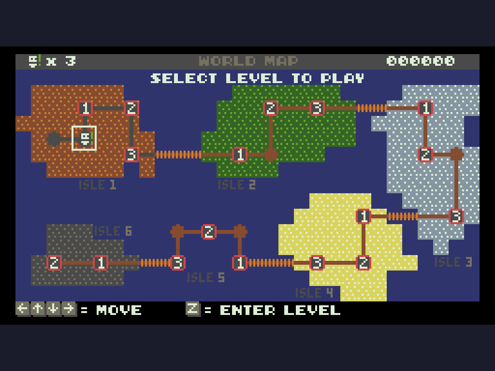 | **8 Bit Panda**, Bruno Oliveira. `8-bit-panda` | Platformer: 17 levels on 6 islands, a world map, power-ups. The top-rated game on tic80.com. | Stick, A jump, B attack | Apache 2.0, for code, art and music ([README](https://github.com/btco/panda/blob/master/README.md)) |
| 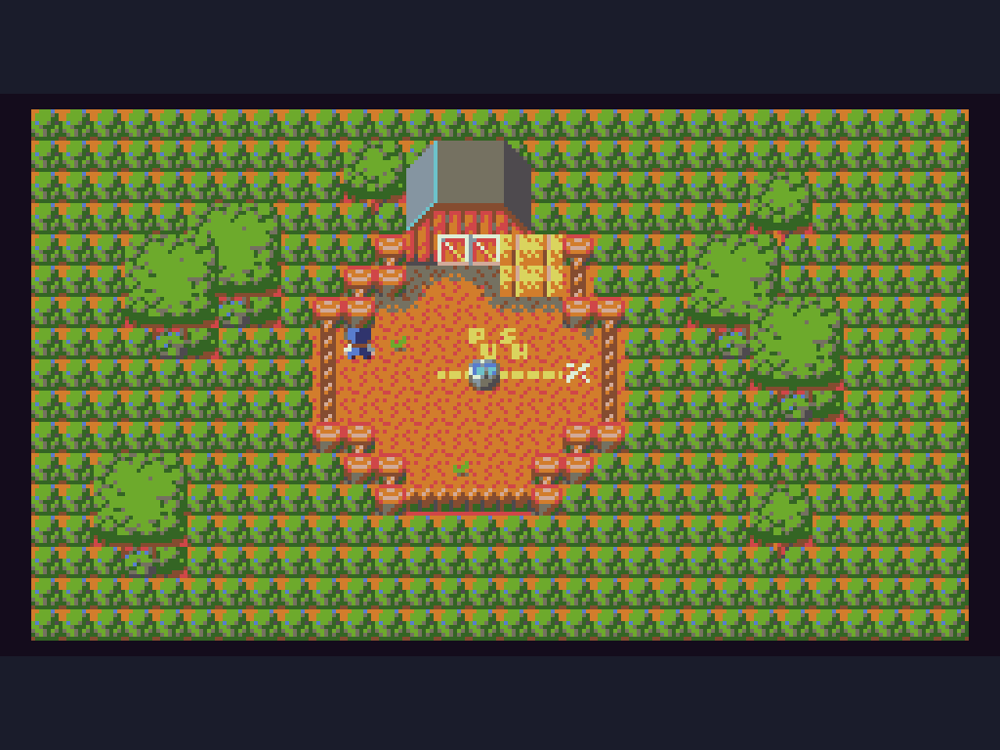 | **Cauliflower Power**, Librorumque. `cauliflower-power` | Push-the-buckets puzzle with guards to avoid. Slow and thinky; has a tutorial and keeps progress. | Stick, A shows what guards see, B restarts, X next message | MIT, the full text is inside the cart |
| 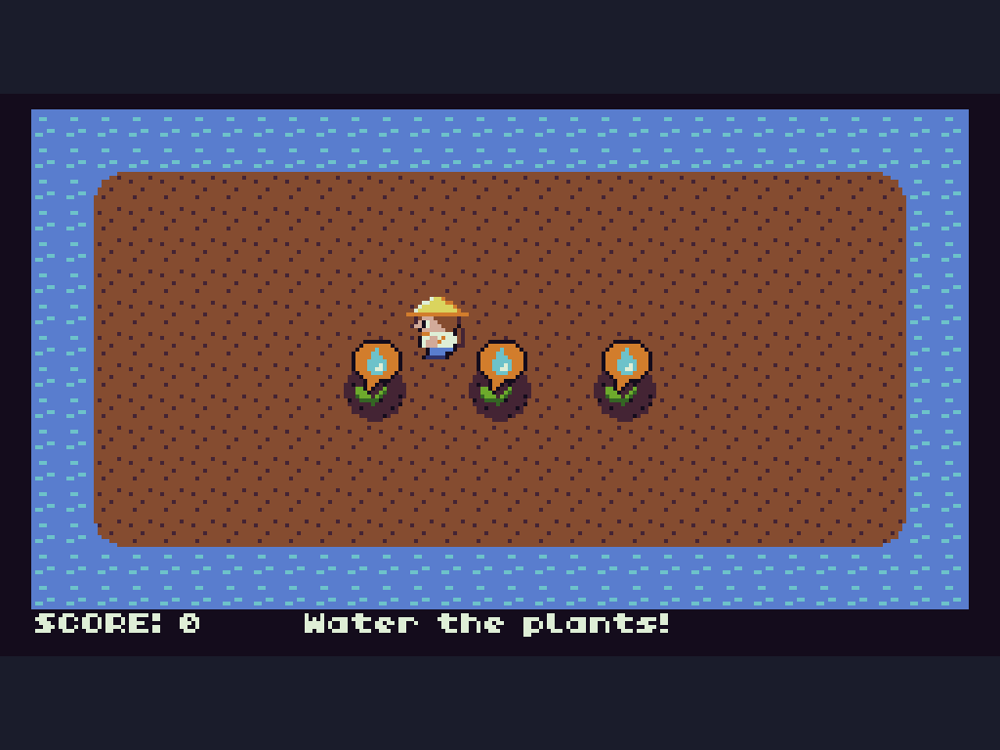 | **Grow Quickly**, Cong. `grow-quickly` | Water plants, pick fruit, shoo crows, for a score. Gentle and short. | Stick, A | MIT ([LICENSE](https://github.com/cxong/GrowQuickly/blob/master/LICENSE)) |
| 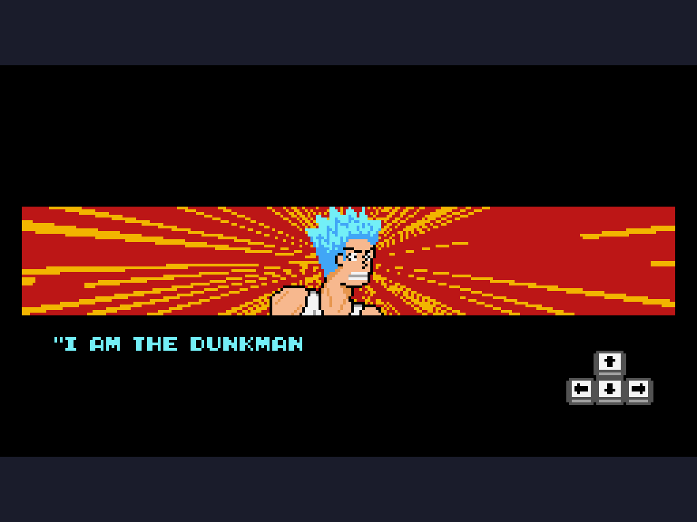 | **Dunkman**, Cong. `dunkman` | One-screen basketball: get past defenders and dunk. Short rounds, good for turns. | Stick, A, B | MIT ([LICENSE](https://github.com/cxong/Dunkman/blob/master/LICENSE)) |

**My pick of three:** 8 Bit Panda, Cauliflower Power, Grow Quickly. Dunkman is the spare.

Two more passed the licence check and aren't built: **Retro Gunner** (a shoot-'em-up, the most arcade-like; "MIT" only as a one-line header in the cart, which may be TIC-80's default text) and **EntroPipes** (a pipe puzzle, GPL-3.0). Carts with no stated licence were left out: tic80.com's terms say not to redistribute a cart without its author's permission.

## Homebrew, in RetroArch

| | Game | What it is | Buttons | Licence |
|---|---|---|---|---|
| 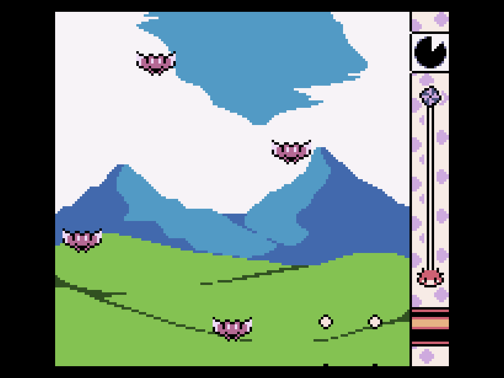 | **Tobu Tobu Girl Deluxe**, Tangram Games. Game Boy Color. `tobu-tobu-girl-deluxe` | Bounce up off the baddies to rescue your cat. Fast arcade runs with high scores; the most polished of the lot. Fairly hard. | Stick, A jump, B dash, START | Code MIT, art and music CC BY 4.0 ([README](https://github.com/SimonLarsen/tobutobugirl-dx)). Needs a credit, which its NOTICE carries. |
| 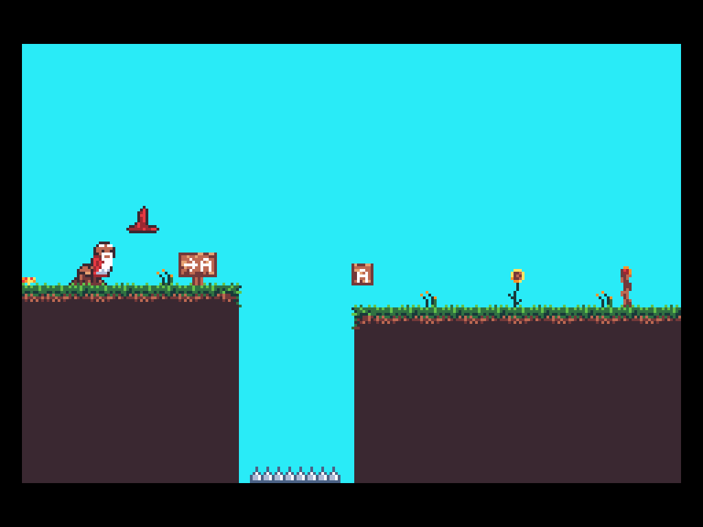 | **The Hat Chooses the Wizard**, Corwin Kuiper and Gwilym Inzani. Game Boy Advance. `hat-wizard` | Throw your hat, then fly to it. A short, cute platformer. | Stick, A jump, B hat | Code MPL-2.0, art CC BY-SA 4.0, music CC BY 3.0 ([itch page](https://lostimmortal.itch.io/the-hat-chooses-the-wizard)) |
| 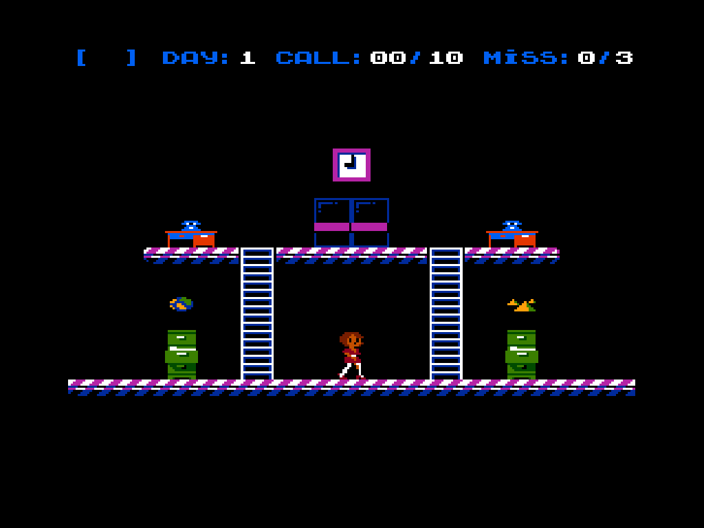 | **Zooming Secretary**, Shiru and PinWizz. NES. `zooming-secretary` | Phones ring; fetch the right folder and answer in time. A one-screen score chase. | Stick, A, START | CC BY, stated in the game's own manual ("released under Creative Commons Attribution license") |
| 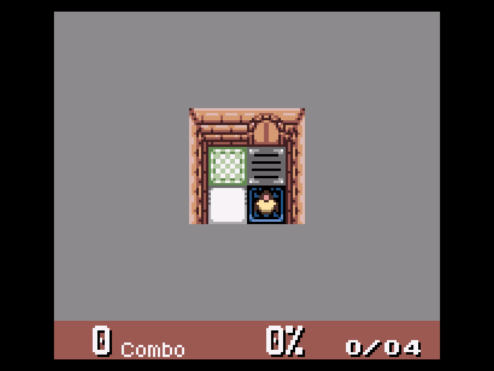 | **Libbet and the Magic Floor**, Damian Yerrick. Game Boy. `libbet` | Roll over every floor tile. A calm logic puzzle, black and white. | Stick, A with the stick jumps, START | zlib ([README](https://github.com/pinobatch/libbet)) |

**My pick of three:** Tobu Tobu Girl Deluxe, The Hat Chooses the Wizard, Zooming Secretary: one for each console the cabinet now plays. Libbet is the spare.

**Looked at and left out:**
- **Anguna** (GBA adventure, MIT): the only big game found, but the licence is stated for its DS source, not the GBA ROM, and it needs SELECT to save. Worth an email to the author.
- **µCity** (GBC city builder, GPLv3): needs SELECT and a lot of reading.
- **Nova the Squirrel** (NES): non-commercial art, and its author asks that it not be used in AI-assisted projects.
- **Alter Ego**, **Lizard**, **Varooom 3D**, **Blind Jump**: no redistribution grant, or assets that can't be redistributed.

## PICO-8

The export works with Geoff's PICO-8 (D389). Geoff picked all five of these carts from the Lexaloffle BBS (2026-11-15); they're in `guests/` (A is PICO-8's O, B its X). Each is CC BY-NC-SA 4.0, set by its author on the cart's BBS post: fine at home, credited, never sold.

| | Game | What it is | Licence |
|---|---|---|---|
| 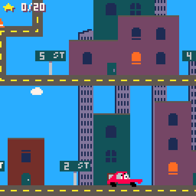 | **Pizza Panda**, Andrew Anderson. `pizza-panda` | Drive the pizza car to every house; 20 short levels, no fighting. | CC BY-NC-SA 4.0 ([post](https://www.lexaloffle.com/bbs/?tid=54289)); also MIT in [his repo](https://github.com/andmatand/pizza-panda) |
| 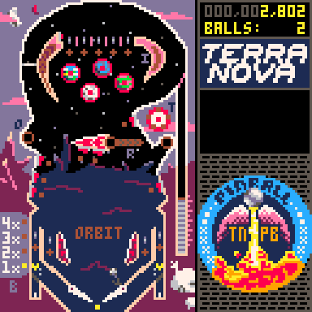 | **Terra Nova Pinball**, Matt Sutton. `terra-nova-pinball` | A full pinball table with a high-score table. | CC BY-NC-SA 4.0 ([post](https://www.lexaloffle.com/bbs/?tid=49068)) |
| 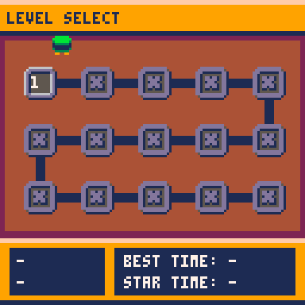 | **Zip Zapper**, ejreyes. `zip-zapper` | A robot zaps its way to the portal in short, calm puzzles. | CC BY-NC-SA 4.0 ([post](https://www.lexaloffle.com/bbs/?tid=53344)) |
| 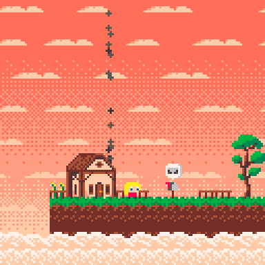 | **Up and Away**, Ross McCormick. `up-and-away` | A hot-air balloon trip between islands to visit Grandma; no way to lose. | CC BY-NC-SA 4.0 ([post](https://www.lexaloffle.com/bbs/?tid=142710)) |
| 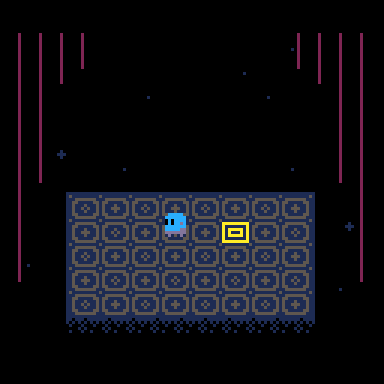 | **Just One Boss**, bridgs. `just-one-boss` | One boss fight on a grid of tiles, stick only. Hard. | CC BY-NC-SA 4.0 ([post](https://www.lexaloffle.com/bbs/?tid=30767)) |

My pick was Pizza Panda, Terra Nova Pinball and Zip Zapper; Geoff took all five.

## The shelf with all eight, in the test VM

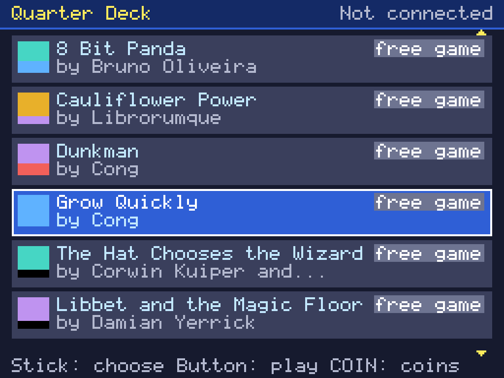

Played from that shelf with the VM's keyboard as the cabinet's controls:

| Grow Quickly (TIC-80) | Tobu Tobu Girl Deluxe (RetroArch) |
|---|---|
| 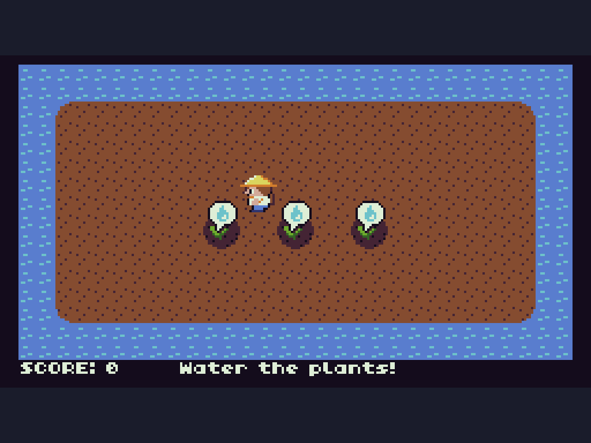 | 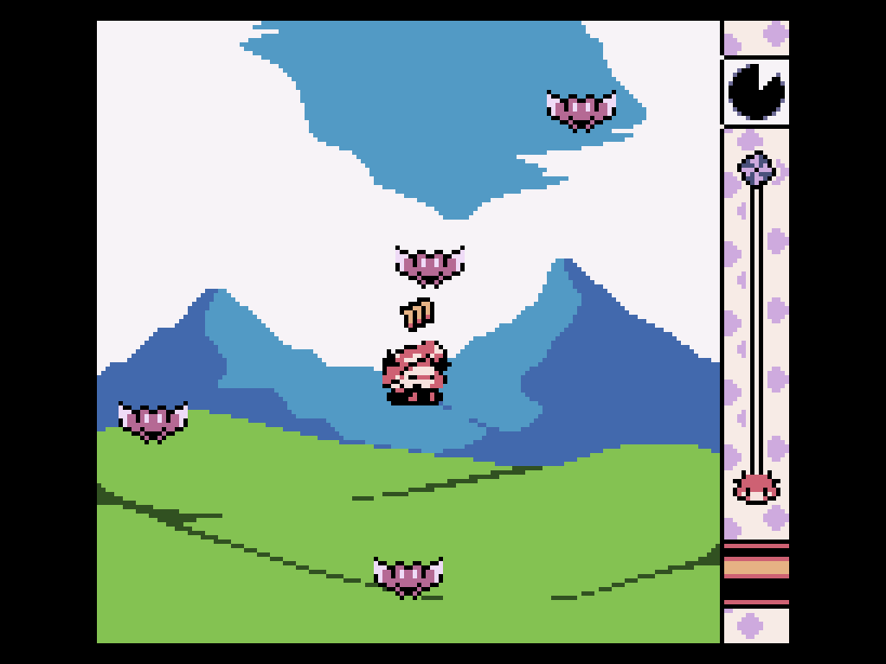 |
